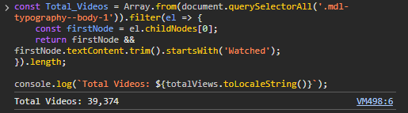
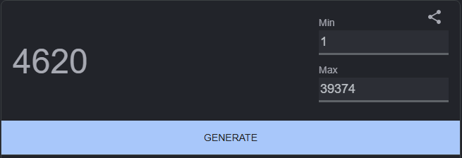
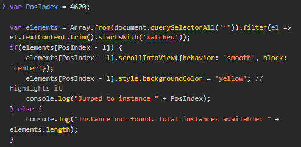
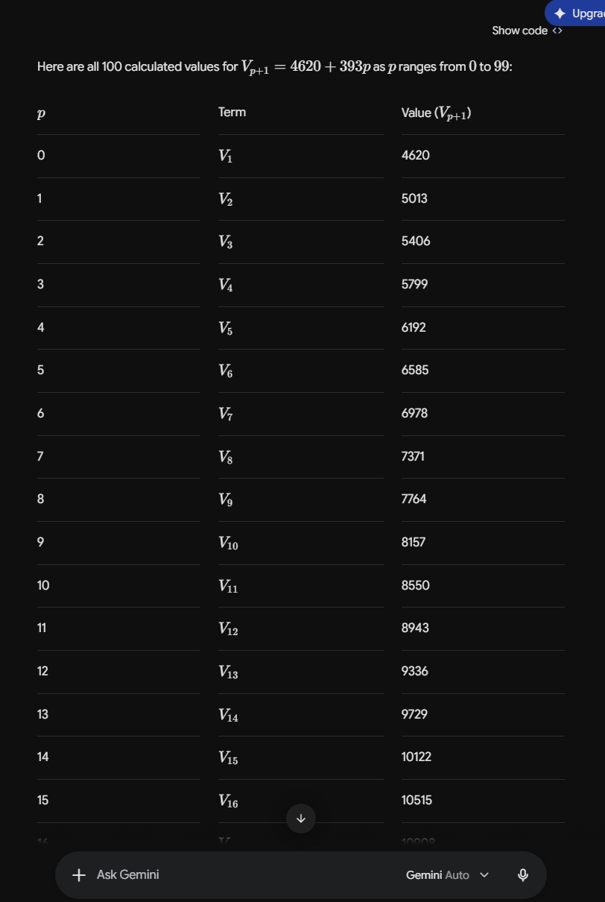

# Data Query

This will be the main file to hold everything associated with the data sourcing and recording.

## Chosen data query to explore: 

What YouTube videos am I more likely to watch/listen to?

## Sub Questions

1. What genres/tags do they fall under?

2. What are the lengths of the videos?

3. Do I watch/listen all the way till the end?

# Sourcing Unbiased Data Points

- I will find out the total number of videos indexed in my YouTube search history.
- The total number of videos will be used to find an interval for choosing videos
going down the search history.
- After this interval is found, a random starting position will be chosen between 
1 and the interval number.
- After the interval and starting position are found, a function can be defined
to systematically sample videos through intervals without bias.

### I = Interval
### V(t) = Total number of videos
### V(0) = Position of first video
### p = Position
### Vp + 1 = Next video position

---

# Total Number of Videos

## V(t) = 39,374

---

# Interval

39,374/100 = 393.74
floor(394.07) = 393

## I = 393

---

# Starting Position

## V(0) = 4620

---

# FINAL EQUATION

---

# HOW TO SELECT EACH VIDEO PER INTERVAL?

Google has a "find and edit" feature that lets you put in a keyword to see how many instances of said word appears. Due to how many videos the watch history file holds, this feature is inneficient for 2 reasons.

1. It takes too long to get to the next video position. It only lets you click and go up by 1 instance each time.

2. The keyword doesn't account for the specific element it is tied to. This means it will capture the keyword "Watched" for not just the block title, but also the title of the video (which we don't want).

## How to work around this?

Using inspect element I can access Chrome DevTools to query and search for an exact index rather than having to continously click for 1 increment after another. This requires using a js script written to do exactly as stated.

This script will be copy and pasted with each of the next positions entered in on the console in inspect element. This will be carried out until 100 data points are recorded.

# HOW I AUTOMATED THE ITERATIVE CALCULATIONS

I passed the image of the final equation into Google Gemini and prompted it to iterate through the equation 99 times. This saves time having to manually calculate the indexes over and over.
