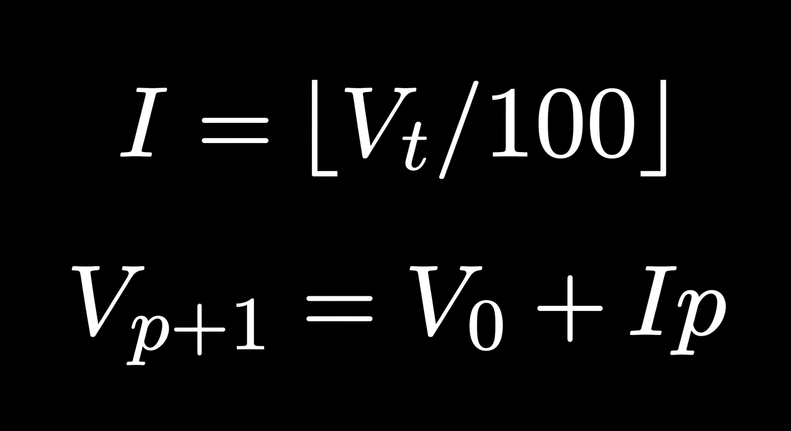

# Data Query

This will be the main file to hold everything associated with the data sourcing and recording.

## Chosen data query to explore: 

What YouTube videos am I more likely to watch/listen to?

## Sub Questions

1. What genres/tags do they fall under?

2. What are the lengths of the videos?

3. Do I watch/listen all the way till the end?

# Sourcing Unbiased Data Points

- I will find out the total number of videos indexed in my YouTube search history.
- The total number of videos will be used to find an interval for choosing videos
going down the search history.
- After this interval is found, a random starting position will be chosen between 
1 and the interval number.
- After the interval and starting position are found, a function can be defined
to systematically sample videos through intervals without bias.

## I = Interval
## V (t) = Total number of videos
## V (0) = Position of first video
## p = Position
## Vp + 1 = Next video position